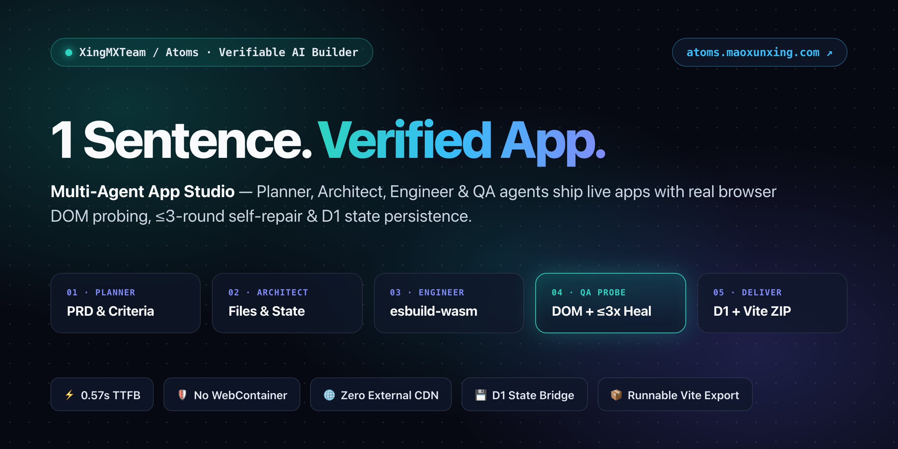
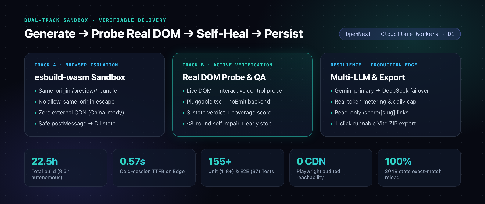

<div align="center">

<a href="https://atoms.maoxunxing.com/">
  
</a>

<br />

<p>
  <a href="https://atoms.maoxunxing.com/">
    
  </a>
  <a href="https://github.com/XingMXTeam/agent-skills">
    
  </a>
</p>

<p>
  
  
  
  
  
</p>

<p>
  <strong>English</strong> · <a href="./README.zh-CN.md">简体中文</a> · <a href="./docs/DELIVERY.md">Engineering Delivery Write-up</a>
</p>

> **Stop shipping "generate-and-pray" AI demos.**
> Describe an app in **one sentence** — Atoms Studio's visible multi-agent pipeline (**Planner → Architect → Engineer → QA**) generates specs, bundles in-browser via `esbuild-wasm`, probes the **real rendered DOM**, self-repairs up to **3 rounds**, persists app state to **Cloudflare D1**, and exports a **runnable Vite ZIP** — with **zero sign-up required**.

</div>

---

## ⚡ Why Atoms Studio Beats "Generate & Pray" Builders

Most text-to-app tools dump unverified JSX into a brittle iframe and hope it compiles. Atoms Studio brings **production harness engineering directly inside the product**:

| Dimension | Typical AI App Builders | **Atoms Studio** |
| :--- | :--- | :--- |
| **Verification** | Generate code once & pray | **Real Browser DOM + Interactive Control Probe** + pluggable backend `tsc --noEmit` sandbox |
| **Self-Healing** | Manual copy-paste of console errors | **≤3-Round Automated QA Self-Repair** with 3-state verdict (`Pass / Fail / Human Review`), coverage score & early stop |
| **Preview Runtime** | Heavy WebContainer / flaky external CDNs | **Same-origin `esbuild-wasm`** (`sandbox="allow-scripts allow-forms"`, **no** `allow-same-origin`, **no WebContainer**) |
| **State Persistence** | Refresh the page → all app data vanishes | **Safe `postMessage` → Cloudflare D1 `project_state` bridge** (hard-refresh a generated 2048 board → 100% exact restore) |
| **Mainland China Reachability** | Broken by `esm.sh` / `unpkg` / Google Fonts | **Zero External CDN at runtime** — Playwright `cdn-audit` fails CI on any disallowed host |
| **LLM Resilience** | Single provider dies on 429/402 | **Gemini Flash/Lite primary → DeepSeek real-time failover** → Turn-1 replay fallback (non-destructive on follow-ups) |
| **Ownership & Export** | Trapped in proprietary preview | **One-click Runnable Vite ZIP** (`npm install && npm run dev`) + read-only `/share/[slug]` links |

---

## 🏗️ Dual-Track Sandbox & Verifiable Delivery

<div align="center">
  
</div>

### How a Single Prompt Turns Into a Verified App

```text
One-Sentence Prompt (Anonymous deviceId · No Sign-Up)
  │
  ▼  Server-Side SSE Pipeline (OpenNext on Cloudflare Workers · aws:us-east-1)
  ├── 01. Planner   → Structured PRD, scope & explicit acceptance criteria
  ├── 02. Architect → File layout, component boundaries & state schema
  ├── 03. Engineer  → React + TypeScript + Tailwind code generation (token-metered)
  └── 04. QA Loop   → Dual-Track Verification (≤3 self-repair rounds + no-progress early stop):
                       • Browser Track: esbuild-wasm renders in isolated iframe → POST /api/.../probe (DOM + controls + runtime errors)
                       • Backend Track: Pluggable sandbox (Cloudflare Sandbox / isolated Node tsc --noEmit / Worker static verifier)
  │
  ▼  Live Workbench & Delivery
  ├── Interactive Desktop / Mobile (375px) Preview + Safe postMessage ↔ D1 State Persistence
  ├── Iterative Follow-Up Prompts + Full Version Timeline & Instant Rollback
  └── One-Click Read-Only /share/[slug] Link + Standalone Runnable Vite ZIP Export
```

---

## 🔥 Built in 22.5 Hours Using Harness-Driven AI Engineering

Atoms Studio is itself a live proof of **human-steered, harness-driven autonomous engineering** (built with [`XingMXTeam/agent-skills`](https://github.com/XingMXTeam/agent-skills)):

- **⏱️ 22.5h calendar span** — **9.5h unattended autonomous agent execution** (including a 5.3h overnight run) + **4.5h focused human architecture review & acceptance across 11 strategic interventions**
- **🚀 75+ commits · 7 merged PRs · 15 closed issues** — continuously green across `typecheck`, `lint`, **118+ Vitest unit tests**, **37 Playwright E2E tests**, and production build
- **⚡ 0.57s cold-session TTFB** on Cloudflare Workers (crushed down from 3.3–4.2s via async session seeding, immutable `/preview/*` caching, and idle `esbuild.wasm` preloading)
- **🎮 100% reload fidelity** — verified end-to-end on generated interactive apps (e.g., React 2048 4×4 board & score exact-match persistence across hard reloads in D1)

> 📖 Read the complete engineering post-mortem, architecture trade-offs, and 11-intervention timeline in [**`docs/DELIVERY.md`**](./docs/DELIVERY.md).

---

## 🛠️ Architecture Overview

```text
Browser (Chinese UI · Light/Dark · Anonymous deviceId)
  ├─ Home / Workbench / Share / Custom 404
  ├─ Live Multi-Agent Timeline + Iterative Follow-Up + Version Rollback
  └─ Isolated iframe preview (sandbox="allow-scripts allow-forms")
       ├─ Same-origin /preview/* (esbuild.wasm · ESM vendor · Tailwind browser)
       └─ Safe postMessage storage bridge ↔ Cloudflare D1 project_state
              ↑
Next.js App Router (OpenNext → Cloudflare Workers, placement: aws:us-east-1)
  ├─ Server-side SSE Multi-Agent Pipeline (Gemini → DeepSeek failover | mock | replay)
  ├─ Pluggable Execution Sandbox (Cloudflare Sandbox / local Node tsc / Worker verifier)
  └─ Drizzle ORM → Cloudflare D1 (prod) / better-sqlite3 (local & E2E)
```

---

## 🚀 Quick Start (Local Development)

Run the full multi-agent workbench locally in 30 seconds — **no LLM API key required** in `mock` mode:

```bash
pnpm install
cp .env.example .dev.vars   # Add local keys if using live Gemini/DeepSeek; never commit secrets
LLM_PROVIDER=mock pnpm dev  # Deterministic mock pipeline for instant local dev & testing
```

### Common Commands

| Command | Description |
| :--- | :--- |
| `pnpm dev` | Start local Next.js dev server |
| `pnpm typecheck` / `pnpm lint` | TypeScript & ESLint static checks |
| `pnpm test` | Run Vitest unit test suite (118+ tests) |
| `LLM_PROVIDER=mock pnpm test:e2e` | Run Playwright E2E & CDN audit (requires `pnpm build` first) |
| `pnpm build` | Production Next.js build |
| `pnpm run build:cf` | OpenNext Cloudflare Workers bundle |
| `fh verify` | Full verification gate (`typecheck` → `lint` → `unit` → `e2e` → `build`) |

---

## 📚 Engineering Docs

- **Full Delivery Write-up & Human-AI Retrospective**: [`docs/DELIVERY.md`](./docs/DELIVERY.md) (alias: [`docs/writeup.md`](./docs/writeup.md))
- **Architecture Decisions & Trade-offs**: [`docs/plan/decisions.md`](./docs/plan/decisions.md)
- **Staged Implementation Plan**: [`docs/plan/implementation_plan.md`](./docs/plan/implementation_plan.md)
- **Live Production Demo**: **[https://atoms.maoxunxing.com](https://atoms.maoxunxing.com)** *(custom domain — do not rely on `*.workers.dev`)*

---

<div align="center">

### Part of Momo's AI Engineering Ecosystem

**[⚡ 27 Agent Skills](https://skills.maoxunxing.com/)** · **[⚛️ Atoms Studio](https://atoms.maoxunxing.com/)** · **[🧠 Prompt Studio](https://prompts.maoxunxing.com/)** · **[🌐 maoxunxing.com](https://maoxunxing.com/)**

<sub>If Atoms Studio sparked an idea for your own verifiable AI product, drop a ⭐ on this repo!</sub>

</div>
