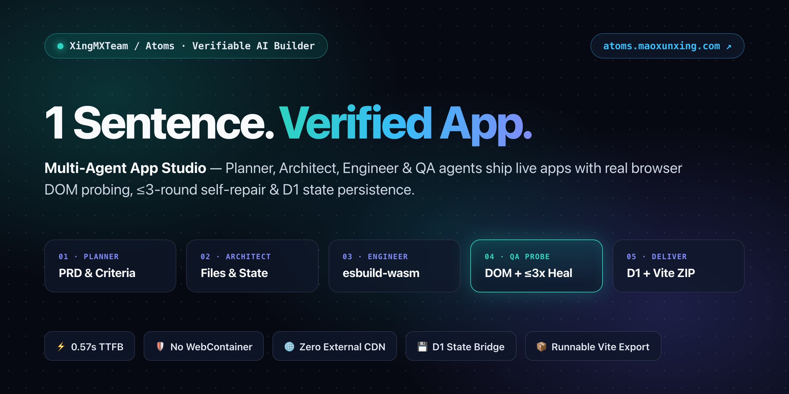
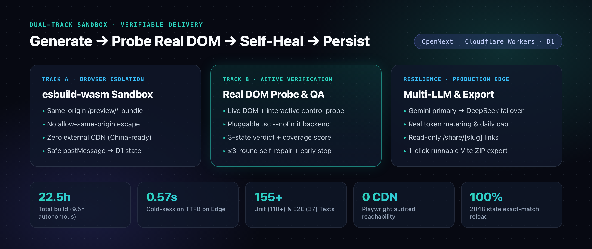

<div align="center">

<a href="https://atoms.maoxunxing.com/">
  
</a>

<br />

<p>
  <a href="https://atoms.maoxunxing.com/">
    
  </a>
  <a href="https://skills.maoxunxing.com/">
    
  </a>
</p>

<p>
  
  
  
  
  
</p>

<p>
  <a href="./README.md">English</a> · <strong>简体中文</strong> · <a href="./docs/DELIVERY.md">完整交付复盘文档</a>
</p>

> **告别「生成即祈祷」的 AI Demo 玩具。**
> 输入**一句话需求**，可见的多 Agent 流水线（**Planner → Architect → Engineer → QA**）自动产出验收标准、在浏览器内用 `esbuild-wasm` 同源秒级打包、接入**真实浏览器 DOM 探针**并完成 **≤3 轮 QA 自修复**、将应用状态持久化到 **Cloudflare D1**，并支持一键导出**独立可运行 Vite ZIP** —— 匿名 `deviceId` 即开即用，**无需注册**。

</div>

---

## ⚡ 为什么 Atoms Studio 不一样？

大多数 Text-to-App 工具只负责把一段未经验证的 JSX 丢进 iframe 就结束；Atoms Studio 把 **Harness 级工程门禁直接做进了产品本身**：

| 对比维度 | 普通「生成即祈祷」AI 建站工具 | **Atoms Studio（可验证的 AI 应用生成）** |
| :--- | :--- | :--- |
| **质量验证** | 盲猜代码能跑，报错全靠肉眼 | **浏览器真实 DOM + 交互控件探针** + 可插拔后台 `tsc --noEmit` 校验沙箱 |
| **失败自愈** | 复制控制台红字手动让 AI 改 | **≤3 轮自动化 QA 自修复**，带三态判定（通过 / 未通过 / 需人工复核）、覆盖率评分与无进展早停 |
| **预览沙箱** | 依赖重型 WebContainer 或海外 CDN | **同源 `esbuild-wasm` 极速打包** + `sandbox="allow-scripts allow-forms"`（严禁 `allow-same-origin`，**不使用 WebContainer**） |
| **状态持久化** | 刷新页面数据瞬间清零 | **安全 `postMessage` → D1 `project_state` 存储桥**（实测生成的 2048 整页刷新后 4×4 棋盘与分数 100% 精准恢复） |
| **中国大陆可达性** | `esm.sh` / `unpkg` / Google Fonts 白屏 | **运行时零外部 CDN**，自托管 `/preview/*`，Playwright `cdn-audit` 违规即红灯 |
| **模型费用** | 每次生成都走平台密钥 | **每位访客仅 1 次平台演示生成**，之后必须 **自带密钥（BYOK）**（Gemini 或 OpenAI 兼容接口）。访客密钥失败不会回退到平台密钥。 |
| **成果带走** | 锁死在在线预览框里 | **一键只读 `/share/[slug]` 分享** + **独立可运行 Vite 脚手架 ZIP 导出**（解压 `npm install && npm run dev` 即跑） |

---

## 🏗️ 双轨沙箱与可验证交付架构

<div align="center">
  
</div>

### 技术亮点一览

- **App Shell**：Next.js App Router + TypeScript，中文界面，light/dark 自动跟随 `prefers-color-scheme`，匿名 `deviceId` Cookie 零门槛体验，支持桌面 / 移动 `375px` 预览切换。
- **可见多 Agent SSE 流水线**：`Planner / Architect / Engineer / QA` 实时状态、真实耗时与增量迭代版本时间线（支持一键回滚）；Provider 支持 `gemini` / `mock` / `replay`。平台密钥只承担每位访客 1 次演示生成，后续迭代使用访客自己的密钥，平台 Token 额度不计入 BYOK。
- **双轨验证沙箱（Plan A + 可插拔后台沙箱）**：
  - 浏览器侧：`esbuild-wasm` 同源极速打包 + `sandbox="allow-scripts allow-forms"` 严格隔离，通过 `POST /api/.../probe` + D1 `preview_probes` 回传真实渲染与交互控件探测报告（超时回退服务端静态探测）。
  - 后台侧：可插拔执行沙箱（`cloudflare-sandbox` 容器 / `local-node-sandbox` 隔离执行真实 `tsc --noEmit` / `worker-static-verifier`）。
- **中国大陆可达性**：运行时不依赖任何外部 CDN；`esbuild.wasm`、白名单 ESM vendor、Tailwind 浏览器构建均自托管在同源 `/preview/*` 并配置 `immutable` 长缓存与空闲预加载。
- **持久化与部署**：Cloudflare D1 + Drizzle ORM（本地 / E2E 使用 `better-sqlite3`，共享同一 repository 接口）；OpenNext 部署至 Cloudflare Workers，绑定自定义域名 `atoms.maoxunxing.com`，Worker 固定 `placement: { region: "aws:us-east-1" }`。

```text
Browser (Chinese UI)
  ├─ Home / Workbench / Share
  ├─ Agent timeline + follow-up + version rollback
  └─ iframe preview ← same-origin /preview/* (esbuild.wasm · vendor · tailwind)
       └─ safe postMessage storage bridge ↔ D1 project_state
         ↑
Next.js (OpenNext Worker, aws:us-east-1)
  ├─ SSE agent pipeline (one platform demo or visitor BYOK | mock | replay)
  ├─ Pluggable backend sandbox (Cloudflare Sandbox / local Node tsc / Worker verifier)
  └─ D1 / SQLite repository
```

---

## 🔥 22.5 小时人机协同实战战绩

本项目完整采用 **Harness 驱动的 AI 无人值守研发 + 人工高杠杆验收**（由 [`XingMXTeam/ShipProof`](https://github.com/XingMXTeam/ShipProof) 驱动）打造：

- **⏱️ 总跨度 22.5 小时**：约 **9.5 小时 AI 无人值守研发**（含夜间连续 5.3 小时）+ **4.5 小时人工架构拍板与真机验收**（仅 **11 次** 关键人工介入）
- **🚀 75+ 次提交 · 7 个合并 PR · 关闭 15 个 Issue**：`fh verify` 全绿（118+ 单测 / 37 个 Playwright E2E）
- **⚡ 冷启动首屏 TTFB 压降至 `0.57s`**（从 3.3–4.2s 优化至 0.57s）
- **🎮 2048 实测硬刷新 `exactMatch: true`**：不放开 `allow-same-origin`，依然实现完整盘面与分数持久化

> 📖 完整思路取舍、11 次人工介入复盘与实测记录详见 [**`docs/DELIVERY.md`**](./docs/DELIVERY.md)。

---

## 🚀 本地开发

无需配置任何 API Key，使用 `mock` 模式 30 秒跑通完整多 Agent 流水线：

```bash
pnpm install
cp .env.example .dev.vars   # 如需联调真实 Gemini/DeepSeek 请填入本地变量；切勿提交真实密钥
LLM_PROVIDER=mock pnpm dev  # 推荐本地开发与测试使用 mock 模式
```

### 模型费用

公开站点无需登录。平台付费模型只保留很薄的演示：

- 未提供密钥时，每位访客只能用平台 `GEMINI_API_KEY` / `DEEPSEEK_API_KEY` **完整生成 1 次**。后续修改和再次完整生成必须使用访客自己的密钥。
- BYOK 支持 Google Gemini API Key，以及 OpenAI 兼容接口（Base URL + API Key + 模型名，因此 DeepSeek 等可用）。密钥只随该次请求使用，不写入 D1、Cookie、事件载荷或应用日志。
- 访客密钥调用失败会明确报错，**不会**改用平台 Gemini 或 DeepSeek。
- 平台演示路径在配置了 `TURNSTILE_SECRET_KEY` 后要求 Cloudflare Turnstile。密钥未配置时演示路径直接拒绝（mock / 演示回放仍可运行）。每日与每月额度只统计**平台密钥**的 Token。
- 清除 `deviceId` Cookie 会签发新设备号，这不是可靠绕过。Turnstile 和全站额度是额外刹车，不能称为防刷。
- 请在持有平台密钥的 Google AI/Cloud 项目上设置较低的预算并开启超限停用。应用内额度不能代替云账单阈值。若保留平台 DeepSeek 密钥，同样设置账单上限。

### 常用脚本

| 命令 | 作用 |
| :--- | :--- |
| `pnpm dev` | 启动本地开发服务器 |
| `pnpm typecheck` / `pnpm lint` | TypeScript 类型与 ESLint 静态检查 |
| `pnpm test` | 运行 Vitest 单元测试（118+ 用例） |
| `LLM_PROVIDER=mock pnpm test:e2e` | 运行 Playwright E2E 与 CDN 审计（需先 `pnpm build`） |
| `pnpm build` | 生产构建 |
| `pnpm run build:cf` | OpenNext Cloudflare Workers 构建 |
| `fh verify` | 一键跑完交付门禁（`typecheck` / `lint` / `unit` / `e2e` / `build`） |

---

## 📚 交付文档

- **详细交付说明（思路取舍 / 完成度 / 22.5h 人机协作复盘 / 部署步骤）**：[`docs/DELIVERY.md`](./docs/DELIVERY.md)
- **短文入口（同内容）**：[`docs/writeup.md`](./docs/writeup.md)
- **产品决策与分阶段实现计划**：[`docs/plan/decisions.md`](./docs/plan/decisions.md)、[`docs/plan/implementation_plan.md`](./docs/plan/implementation_plan.md)
- **线上演示地址**：**[https://atoms.maoxunxing.com](https://atoms.maoxunxing.com)**（不要依赖 `*.workers.dev` 作为评测入口）

---

<div align="center">

### Momo AI 工程生态矩阵

**[⚡ 27 份 Agent Skills](https://skills.maoxunxing.com/)** · **[⚛️ Atoms Studio](https://atoms.maoxunxing.com/)** · **[🧠 Prompt Studio](https://prompts.maoxunxing.com/)** · **[🌐 主站博客](https://maoxunxing.com/)**

<sub>如果 Atoms Studio 对你的 AI 产品工程化有启发，欢迎点个 ⭐ Star 支持！</sub>

</div>
