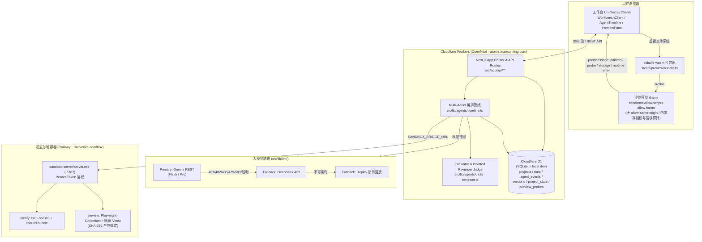
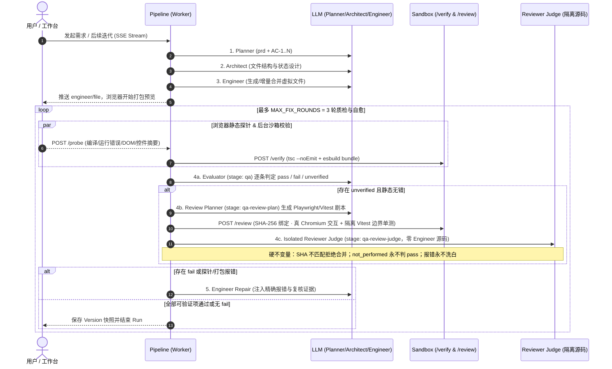

# Atoms Studio 系统架构文档

> 本文档面向研发与维护者，系统性说明 **Atoms Studio** 的整体架构、运行拓扑、Multi-Agent 闭环、双端沙箱预览与智能验收机制、数据持久化方案、模型路由与安全边界。
>
> - **线上地址**：https://atoms.maoxunxing.com
> - **沙箱容器桥**：Railway (`Dockerfile.sandbox` / `sandbox-server/server.mjs`)
> - **迭代交付记录**：[`docs/DELIVERY.md`](./DELIVERY.md)

---

## 1. 整体架构与部署拓扑

Atoms Studio 采用 **「边缘应用宿主（Cloudflare Workers） + 隔离执行沙箱容器（Railway Docker） + 浏览器端沙箱预览（esbuild-wasm + iframe）」** 的三层混合架构，兼顾零冷启动边缘访问、安全隔离、真实无头浏览器交互验收与国内可达性（零外部 CDN）。



### 生产与本地运行环境对照

| 层级 | 生产环境 (`atoms.maoxunxing.com`) | 本地开发环境 (`pnpm dev` / `pnpm test`) |
| :--- | :--- | :--- |
| **Web / API 宿主** | Cloudflare Workers (`@opennextjs/cloudflare`, `wrangler.jsonc` 固定 `aws:us-east-1` 保证 Gemini REST 可达) | Node.js Next.js Dev Server |
| **持久化数据库** | Cloudflare D1 (`env.DB`，支持 `withSession` Bookmark 读写一致性) | 本地 SQLite (`better-sqlite3`, `.data/local.sqlite` 或 `:memory:`) |
| **后台执行与智能验收沙箱** | Railway Docker 容器 (`SANDBOX_BRIDGE_URL` → `/verify` + `/review`)；未配置时自动降级为 Worker 静态策略校验器 | 自动使用本机隔离临时目录子进程（`local-node.ts` + `local-reviewer.ts`，直跑 `tsc`、`esbuild`、Playwright Chromium、Vitest） |
| **浏览器内预览编译** | 同源 `public/preview/esbuild.wasm` + 自托管 `runtime.js` / `tailwind-browser.js` | 同左（零外部 CDN） |

---

## 2. 仓库核心目录结构

```text
├── Dockerfile.sandbox                 # 生产沙箱镜像 (mcr.microsoft.com/playwright:v1.56.0-noble)
├── sandbox-server/                    # 独立沙箱 HTTP 服务 (GET /health, POST /verify, POST /review)
├── migrations/                        # D1 / SQLite DDL 迁移脚本 (0000_init, 0001_preview_probes, 0002_project_state)
├── public/preview/                    # 浏览器预览自托管静态资产 (esbuild.wasm, tailwind.css, vendor/*)
├── scripts/                           # 预览 vendor 打包脚本 (build-preview-vendor.mjs)
├── e2e/                               # Playwright 端到端测试套件
└── src/
    ├── middleware.ts                  # 安全响应头 (CSP / X-Frame-Options / Referrer-Policy)
    ├── app/
    │   ├── page.tsx                   # 首页（Prompt 输入、示例与历史项目）
    │   ├── projects/[projectId]/      # 工作台页面
    │   ├── share/[shareSlug]/         # 只读分享页
    │   └── api/
    │       ├── session/projects/      # 匿名设备维度项目列表
    │       └── projects/              # 创建项目、导出 ZIP、分享、状态持久化、版本恢复、SSE 运行流与续跑
    ├── components/
    │   ├── home/                      # 首页表单与项目卡片
    │   ├── share/                     # 只读分享视图
    │   └── workbench/                 # WorkbenchClient, AgentTimeline, QaTimelineCard, PreviewPane, CodePane
    └── lib/
        ├── agents/                    # Planner / Architect / Engineer / QA / Isolated Reviewer / Pipeline
        ├── auth/                      # 匿名 deviceId Cookie 签发与校验
        ├── db/                        # Drizzle Schema + D1/SQLite 双适配器 + Repository
        ├── exports/                   # 一键导出可运行 Vite 项目 ZIP (jszip)
        ├── http/                      # 安全响应头工具
        ├── limits/                    # 单设备每日运行次数 & 全站每日 Token 上限控制
        ├── llm/                       # 模型路由 (Flash/Pro)、Gemini/DeepSeek/Mock/Replay 适配器与各阶段 Prompt
        ├── preview/                   # esbuild-wasm 虚拟打包、安全沙箱策略、存储桥、探针 Schema
        └── sandbox/                   # 沙箱统一调度 (runner.ts)、Cloudflare/Railway 桥接、本地执行与安全策略门禁
```

---

## 3. Multi-Agent 生成、智能验收与自愈闭环

核心编排位于 [`src/lib/agents/pipeline.ts`](../src/lib/agents/pipeline.ts)，通过 SSE（`GET /api/projects/[projectId]/runs/[runId]/stream`）将各阶段事件实时推送至工作台时间线：



### 关键工程约束

1. **三态 QA 判定与覆盖率真实计分**（[`src/lib/agents/qa.ts`](../src/lib/agents/qa.ts)）
   - 每条验收标准支持 `pass`（已验证通过）、`fail`（存在错误或行为不符）、`unverified`（仅在无沙箱能力且静态探针无法测出时诚实保留为「需人工复核」）。
   - `aggregateQaScore` 对全部 `unverified` 返回 `0` 分而非虚假 `100` 分，并在 UI 顶部展示真实自动实测覆盖率（如 `自动实测 4/4`）。
2. **隔离智能验收与防自证机制**（[`src/lib/agents/reviewer.ts`](../src/lib/agents/reviewer.ts)、[`src/lib/sandbox/review-types.ts`](../src/lib/sandbox/review-types.ts)）
   - **SHA-256 产物绑定**：`computeFilesSha256` 对规范化排序后的文件集合计算摘要，任何文件篡改或版本错位都会导致复核结果被拒绝合并。
   - **混合验证策略**：常规键盘/点击/表单/刷新持久化交由 **Playwright 无头 Chromium** 真跑并抓拍 JPEG 关键帧；深层状态机边界（如 2048 满盘死局弹窗、分数累加边界）交由隔离 **Vitest + jsdom** 单测验证。
   - **动态单测静态安全门禁**：`validateVitestCodeSafety` 在执行任何 LLM 生成的测试脚本前强制拦截 `fs`、`child_process`、`http`、`process.env`、`eval`、`require()`、外部 URL 与越界导入。
   - **防停滞早停**：连续两轮产生完全相同的失败签名时触发早停保护，避免无效烧 Token。
3. **运行后预览/运行时异常零点击自愈**（[`preview-pane.tsx`](../src/components/workbench/preview-pane.tsx)、[`workbench-client.tsx`](../src/components/workbench/workbench-client.tsx)、[`agent-timeline.tsx`](../src/components/workbench/agent-timeline.tsx)）
   - 若生成已完成，用户在交互中触发未捕获的 `error` / `unhandledrejection` 或打包报错，前端不弹出手动修复按钮，而是直接通过 `continue` 接口自动拉起一轮工程师修复（内置同错误去重、单次会话最多自动补修 2 次与上限保护）。

---

## 4. 双端隔离预览与持久化状态桥

### 4.1 零外部 CDN 的浏览器内打包（`esbuild-wasm`）

- [`src/lib/preview/bundle.ts`](../src/lib/preview/bundle.ts) 在浏览器中初始化同源 `/preview/esbuild.wasm`，通过虚拟插件 `atoms-virtual-fs` 将生成的多文件 React + TS 项目打包为单一 **classic IIFE**（不透明 `srcdoc` iframe 禁用 `<script type="module">`）。
- 支持本地 `.css` 导入并自动剥离 Tailwind v4 `@import "tailwindcss"` / `@tailwind ...` 指令，与页面内置自托管 Tailwind 运行时（`/preview/tailwind.css` + `/preview/vendor/tailwind-browser.js`）及 React 单例运行时（`/preview/vendor/runtime.js`）无缝合并。
- 严格拦截任何未加入白名单的第三方包及外部 CDN（如 `esm.sh`、`unpkg.com`、`fonts.googleapis.com`、`cdn.tailwindcss.com`）。

### 4.2 安全沙箱与持久化闭环

- **iframe 隔离**：[`src/lib/preview/sandbox.ts`](../src/lib/preview/sandbox.ts) 强制使用 `sandbox="allow-scripts allow-forms"`，**严禁授予 `allow-same-origin`**，使生成代码运行在完全不透明的隔离源中，无法读取宿主 Cookie 或 D1 凭据。
- **跨刷新状态持久化**（[`src/lib/preview/storage-bridge.ts`](../src/lib/preview/storage-bridge.ts)）：
  - `buildPreviewSrcdoc` 在生成代码执行前注入安全 `window.localStorage` 代理垫片，将初始状态注入内存并把每次 `setItem`/`removeItem`/`clear` 通过 `postMessage` 同步给宿主 `PreviewPane`。
  - 宿主在本地缓存并防抖（120ms + `pagehide` `keepalive` 兜底）写入 `PUT /api/projects/[projectId]/state`，落库至 `project_state` 表；整页重开时由服务端读取快照重新注入预览。
  - 在远程沙箱 Playwright `/review` 场景中，[`buildStandaloneReviewHtml`](../src/lib/preview/bundle.ts) 保留原生 `window.localStorage` 于临时 `127.0.0.1` 源上，以真实执行 `page.reload()` 验证应用的持久化逻辑。

---

## 5. 数据模型与 API 设计

数据层通过 [`src/lib/db/index.ts`](../src/lib/db/index.ts) 自动感知运行环境：Cloudflare Workers 下绑定 `env.DB`（D1 + Session Bookmark 保证读写一致），Node 环境下懒加载 `better-sqlite3`，Schema 由 [`migrations/`](../migrations/) 与 [`src/lib/db/schema.ts`](../src/lib/db/schema.ts) 统一定义。

### 核心数据表

| 表名 | 用途 | 关键字段 |
| :--- | :--- | :--- |
| `projects` | 项目主记录与分享入口 | `id`, `device_id`, `title`, `current_version_id`, `share_slug` |
| `messages` | 对话与增量迭代历史 | `id`, `project_id`, `role` (`user`/`agent`), `content` |
| `runs` | 单次生成/修复运行实例 | `id`, `project_id`, `status`, `qa_rounds`, `qa_score`, `tokens_in`, `tokens_out` |
| `agent_events` | 全链路有序事件流 (SSE 重放源) | `id`, `run_id`, `seq`, `agent`, `type` (`plan`/`design`/`file`/`probe`/`review`/`verdict`/`fix`/`error`), `payload` |
| `versions` | 不可变版本快照（支持一键回滚） | `id`, `project_id`, `run_id`, `parent_id`, `files`, `acceptance`, `qa_score`, `summary` |
| `preview_probes` | 客户端浏览器探针上报缓存 | `(run_id, round)`, `report` |
| `project_state` | 生成应用的持久化运行态快照 | `project_id`, `state_json`, `updated_at` |
| `usage` | 按设备与 UTC 日期统计的配额用量 | `(device_id, day)`, `runs`, `tokens` |

### 主要 API 路由

| 路由 | 方法 | 职责 |
| :--- | :--- | :--- |
| `/api/projects` | `POST` | 创建项目与首个 Run，校验匿名设备与全站限额 |
| `/api/session/projects` | `GET` | 查询当前匿名设备下的项目列表（首次访问按需挂载示例项目） |
| `/api/projects/[projectId]/runs/[runId]/stream` | `GET` | SSE 实时流式推送 Multi-Agent 阶段与质检事件 |
| `/api/projects/[projectId]/runs/[runId]/probe` | `POST` | 接收浏览器预览探针报告并写入 `preview_probes` |
| `/api/projects/[projectId]/runs/[runId]/continue` | `POST` | 中断续跑、后续增量需求迭代，或前端自动自愈触发 |
| `/api/projects/[projectId]/state` | `GET` / `PUT` | 读取与保存生成应用的持久化状态快照 |
| `/api/projects/[projectId]/versions` | `GET` / `POST` | 列出历史版本与恢复指定版本为当前版本 |
| `/api/projects/[projectId]/share` | `POST` | 生成只读分享链接 `/share/[shareSlug]` |
| `/api/projects/[projectId]/export` | `GET` | 打包导出标准可运行 Vite + React + Tailwind 项目 ZIP |

---

## 6. 模型路由、降级策略与限额治理

- **按阶段分级路由**（[`src/lib/llm/model-routing.ts`](../src/lib/llm/model-routing.ts)、[`src/lib/env.ts`](../src/lib/env.ts)）：
  - `planner` / `architect` / `qa` / `qa-review-plan` / `qa-review-judge` → Flash 级模型（默认 `gemini-3.1-flash-lite`），低温度（QA 系列 `temperature: 0.1`）+ 严格 JSON `responseSchema`。
  - `engineer` / `engineer-repair` → Pro 级代码生成模型（默认 `gemini-3.8-flash`）。
- **三级高可用降级**（[`src/lib/llm/modes/gemini.ts`](../src/lib/llm/modes/gemini.ts)、[`deepseek.ts`](../src/lib/llm/modes/deepseek.ts)、[`replay.ts`](../src/lib/llm/modes/replay.ts)）：
  1. 主链路 Gemini REST（遇 `404`/`429`/`503`/超时先向 Flash 重试或降级；遇 `401`/`402`/`403` 当次运行熔断短路）。
  2. 自动切换实时备选 **DeepSeek**（`deepseek-chat`，JSON Object 模式）。
  3. 仍不可用或触发配额阈值时，首次运行降级为带「演示回放」横幅的预录回放；**增量迭代/修复运行严禁回放覆盖**，直接报错保护现有版本代码不被破坏。
- **配额与免登录鉴权**（[`src/lib/auth/device-id.ts`](../src/lib/auth/device-id.ts)、[`src/lib/limits/rate-limit.ts`](../src/lib/limits/rate-limit.ts)）：
  - 通过 `HttpOnly` `deviceId` Cookie 实现免登录数据隔离。
  - 默认限制单设备每日运行次数 `DEVICE_DAILY_RUN_LIMIT=20`、全站每日总 Token `DAILY_TOKEN_CAP=500000`。

---

## 7. 安全边界与运维验证

- **HTTP 安全头**（[`src/middleware.ts`](../src/middleware.ts)、[`src/lib/http/security-headers.ts`](../src/lib/http/security-headers.ts)）：全站下发严格 CSP（`frame-ancestors 'none'`、`object-src 'none'`、`img-src 'self' data: blob:`）、`X-Content-Type-Options: nosniff`、`X-Frame-Options: DENY` 及 HSTS。
- **沙箱服务鉴权**：Railway `sandbox-bridge` 通过 `SANDBOX_BRIDGE_TOKEN` Bearer 校验保护 `/verify` 与 `/review`，未携带合法 Token 返回 `401`。
- **常用开发与部署命令**：
  - `pnpm dev`：本地 Next.js 开发（自动使用本地 SQLite + 本机 Playwright/Vitest 沙箱）
  - `pnpm typecheck && pnpm lint && pnpm test`：类型检查、ESLint 与 Vitest 全量单测（含真实 Playwright + Vitest 智能验收测试）
  - `pnpm test:e2e`：Playwright 端到端回归测试（含零外部 CDN 审计）
  - `pnpm build:cf && npx wrangler deploy`：构建并发布至 Cloudflare Workers (`atoms.maoxunxing.com`)
