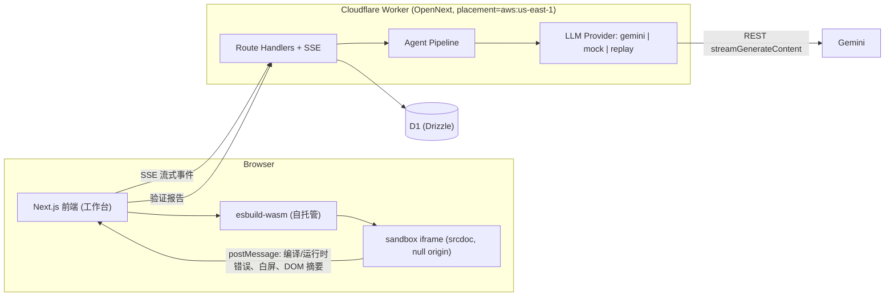
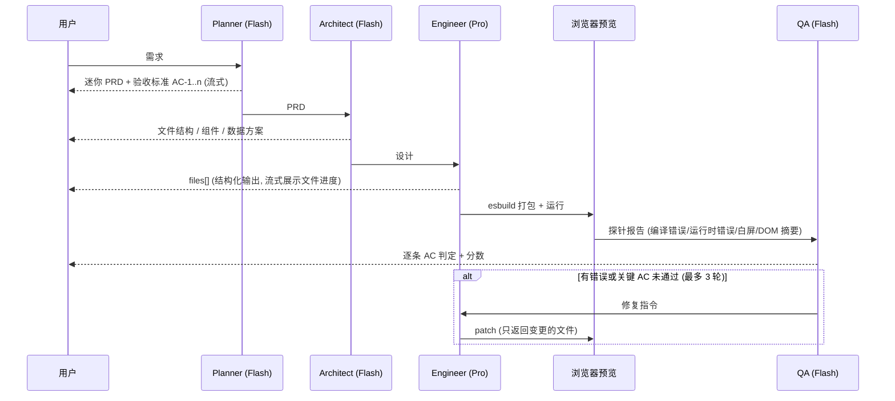

# 实施计划 —— 方案 A（稳健优先）· 专注时长控制在 14h 以内 · 由 Claude Code 驱动 harness

> 环境核对结果：`XingMXTeam/Atoms` 是空仓库 ✅ · `gh` 已登录 ✅ · Claude Code 2.1.312 ✅ · Node 26 ✅ · **wrangler 未登录 ❌** · `fh` 未安装（开工时安装）

---

## 1. 产品定位（区别于“又一个 AI 生成网页”）

**一句话**：*可验证的 AI 应用生成*。每次生成都附带验收标准、QA 评分和自修复记录，而不是“生成完就算结束”。

- 需求 → 验收标准 → QA 逐条检查，**全链路可追溯**（这正是 harness 理念的产品化）
- Agent 团队过程可见：Planner / Architect / Engineer / QA 各自的产出、耗时、修复轮次
- 每个版本带 QA 分数徽章，可以回滚到任意版本

---

## 2. 架构

| 决策 | 选择 | 理由 |
|---|---|---|
| 部署 | Next.js App Router + **@opennextjs/cloudflare** | 成熟，Claude Code 熟悉（另一个选项 vinext 见文末问题） |
| LLM 调用 | Worker 服务端直接请求 Gemini REST SSE，**显式 placement 到 us-east-1** | 绕开 HKG 地区限制，Key 不会暴露给前端 |
| 模型分工 | Pro 档负责 Engineer；Flash 档负责 Planner / Architect / QA | 平衡质量、速度和成本（具体型号开工时按当时可用版本确定） |
| 预览 | 浏览器内用 esbuild-wasm 打包多文件 React + TS | 不依赖 WebContainer，所有浏览器都能用 |
| **国内可达** | esbuild.wasm、React 等白名单依赖的 ESM 包、Tailwind browser 构建，**全部从自己的域名提供** | 不依赖 esm.sh / unpkg / tailwind CDN |
| 持久化 | D1：项目、消息、运行记录、Agent 事件、版本；生成应用自身的数据用 localStorage | 满足硬性要求；匿名 deviceId 隔离 |
| 安全 | iframe 用 `sandbox="allow-scripts"`，不加 allow-same-origin | 生成的代码无法读取宿主的 cookie |

---

## 3. Agent 流水线

- **迭代对话**：后续消息会带上当前文件，Engineer 只返回变更的文件，然后生成新版本。
- **结构化输出**：通过 Gemini 的 `responseSchema` 保证 JSON 可解析；解析失败时自动重试 1 次。
- **中断处理**：SSE 断开时，本次运行标记为 `interrupted`，界面上可以“继续”（已知限制，写进文档）。

---

## 4. 数据模型（D1）

| 表 | 关键字段 |
|---|---|
| `projects` | id, device_id, title, current_version_id, share_slug, created_at, updated_at |
| `messages` | id, project_id, role(user/agent), content, created_at |
| `runs` | id, project_id, status, qa_rounds, qa_score, tokens_in/out, started_at, finished_at |
| `agent_events` | id, run_id, seq, agent(planner/architect/engineer/qa), type(plan/design/file/probe/verdict/fix/error), payload JSON |
| `versions` | id, project_id, run_id, parent_id, files JSON, acceptance JSON, qa_score, summary |
| `usage` | device_id, day, runs, tokens（用于限流） |

---

## 5. 可靠性与兜底（防止“链接坏了”）

- **Provider 有三种模式**：`gemini`（生产）、`mock`（e2e 用，输出固定）、`replay`（Gemini 报错、超时或额度耗尽时自动切换，回放预录的示例运行，界面上明确标注“演示回放”）
- **限流**：每个 deviceId 每天 20 次运行，单 IP 每分钟上限，全局每日 token 上限，超过后进入 replay 模式
- **冷启动**：首页放 4 个示例 prompt + 2 个预置的已完成项目（种子数据）

---

## 6. 界面（自己的产品视角）

- **首页**：中央输入框 + 示例卡片 + “我的项目”网格（显示缩略信息和 QA 分数）
- **工作台**：左栏是对话 + **Agent 时间线**（角色卡片：状态、耗时、可展开查看 PRD / 设计 / 文件变更 / QA 报告）；右栏是 Tab：**预览**（桌面/移动宽度切换、刷新）· **代码**（文件树 + CodeMirror）· **版本**（时间线 + 分数 + 回滚）
- **顶栏**：分享只读链接、下载 zip
- 中文界面，暗色/亮色跟随系统

---

## 7. harness 拆分与时间预算（全部完整闭环）

| Feature | 范围 | 估时（含 harness 开销） |
|---|---|---|
| **F1 foundation** | 脚手架、OpenNext 部署到自定义域名、D1 + Drizzle、deviceId、Provider 抽象（gemini/mock/replay）、限流、`fh verify` 门禁（typecheck / lint / vitest / Playwright e2e / build） | 2.5h |
| **F2 generate-loop** | Planner→Architect→Engineer 流水线、SSE、Agent 时间线 UI、esbuild 预览、生成结果持久化、首页和项目列表 | 3.5h |
| **F3 qa-self-heal** | iframe 探针、QA 逐条判定 AC、自动修复循环（≤3 轮）、分数徽章 | 2h |
| **F4 iterate-versions** | 迭代对话（增量 patch）、版本时间线和回滚、分享只读链接、下载 zip、种子数据 | 2h |
| 交付 | 说明文档（思路/取舍、完成度、后续规划及优先级）、国内网络冒烟测试、最终部署 | 1h |
| **合计** | | **约 11h**（预留约 2.5h 缓冲） |

**超时时的砍功能顺序**：下载 zip → 分享链接 → 移动宽度切换 → Architect 和 Planner 合并为一个角色（时间线仍然展示）。**F1–F3 不砍。**

**e2e 用例**：至少覆盖 core（生成→预览）、negative（编译错误→自修复）、persistence（刷新后项目还在）、uiJourney（迭代→回滚），全部基于 mock provider，保证结果可确定。

---

## 8. 执行流程与分工

| 步骤 | 负责人 | 内容 |
|---|---|---|
| 0 | **你** | ① `npx wrangler login` ② 确认域名已托管在 Cloudflare ③ 在仓库根目录 `.dev.vars` 写入 `GEMINI_API_KEY`（已在 gitignore 中），部署时执行 `wrangler secret put GEMINI_API_KEY`，Key 不经过我 |
| 1 | 我 | 在 `/Users/felix/Documents/atoms` 执行 `git init`，关联 `XingMXTeam/Atoms`；用 create-next-app 建最小脚手架作为 commit 0（`fh init` 需要从 package.json 识别技术栈）；安装 `fh`；执行 `fh init --host claude-code` |
| 2 | 我 | 把本计划拆成 `docs/prd/F1..F4.md`，再写一份 `CLAUDE.md` 项目上下文（架构决策、红线：国内可达、不用外部 CDN、Key 只放服务端） |
| 3 | 你 + Claude Code | 在仓库里打开 Claude Code，粘贴我准备好的启动 prompt → 按 F1→F4 依次执行 `fh new Fx --prd docs/prd/Fx.md` → 每个 feature 只在 **clarify 确认**时需要你点头 |
| 4 | 我 | 每个 feature 完成后做独立复核：线上冒烟测试、读 `fh report`，有问题反馈给你 |
| 5 | 我 + 你 | 完成说明文档，把链接回填到笔试文档 |

---

## 9. 风险

| 风险 | 应对 |
|---|---|
| OpenNext 对 SSE 或 D1 有兼容问题 | F1 第一件事就是部署一个能流式输出的 hello world 到自定义域名，**先验证部署链路** |
| Gemini 结构化输出不稳定或截断 | 用 schema 约束 + 修复重试；限制生成规模（≤8 个文件），Planner 负责控制范围 |
| esbuild-wasm 体积大（约 10MB） | 自托管并设置长缓存；首页空闲时预加载 |
| harness 的 clarify 链拖慢进度 | 用 `--prd` 导入，clarify 阶段只问缺口 |

---

## 10. 开工前请确认

1. **自定义域名是哪个？** 计划用什么子域名（例如 `atoms.你的域名`）？
2. **OpenNext 还是 vinext？** Cloudflare 官方现在默认推荐 vinext（基于 Vite 重新实现 Next API）。我建议用 **OpenNext**，因为更成熟、Claude Code 更熟悉，对笔试来说稳定性优先。
3. **Claude Code 的运行方式**：(a) **交互式会话**（推荐：clarify 确认很自然，你能随时看到进度）(b) `fh run --agent-cmd "claude -p --permission-mode acceptEdits {prompt}"` 无头运行，由我在后台监控。
4. 第 1–2 步（脚手架 + PRD + CLAUDE.md）由我来做，可以吗？还是也全部交给 Claude Code？
