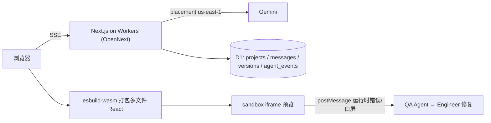
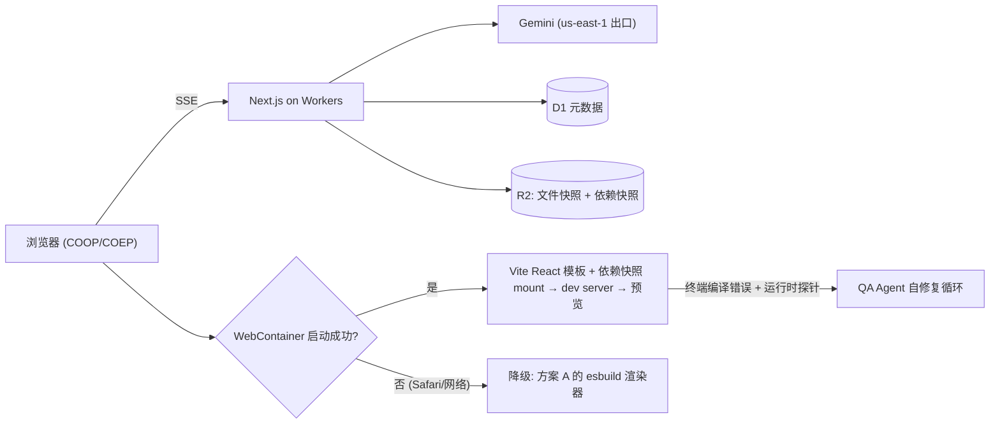
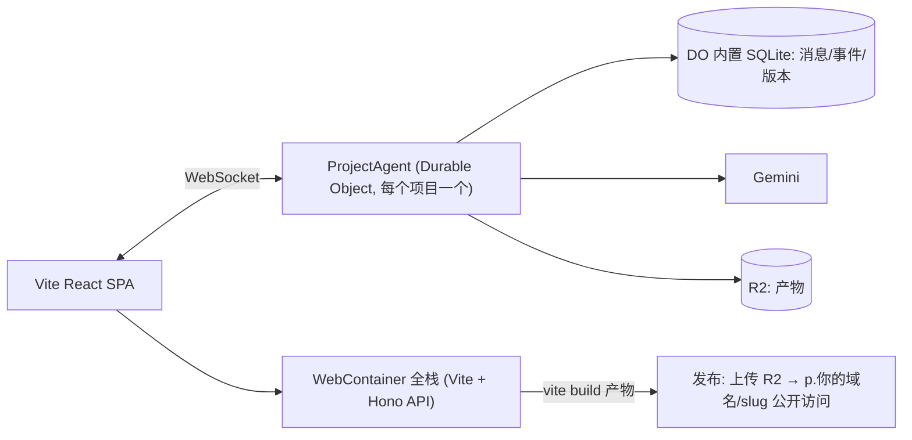

# Atoms Demo —— 3 版方案对比

> 已对齐的约束：10:30 开始计时，**截止时间为 11-25 10:30，还剩约 42h** · Gemini Key · Cloudflare · Next.js + TS · WebContainer · 亮点选“多 Agent 协作可视化 + 生成即验证（QA 自修复）” · 所有 feature 完整走 harness 闭环 · 突出自己的产品视角

---

## 0. 先指出你的选择之间的 4 处冲突（每版方案都必须处理）

| # | 冲突 | 后果 | 处理方式 |
|---|---|---|---|
| 1 | **Gemini 和“国内可达”** | 浏览器不能直连 Gemini。即使走 Worker 服务端调用，国内用户也常被路由到 **HKG 机房**，而 Gemini 对香港返回 `User location is not supported` | 只在服务端调用，并在 `wrangler` 中设置显式 placement：`"placement": {"region": "aws:us-east-1"}`，把出口固定在美国 |
| 2 | **`*.workers.dev` / `*.pages.dev` 在国内基本被墙** | 评审可能打不开链接，直接 0 分 | **必须绑定自定义域名**（见文末问题 1） |
| 3 | **WebContainer 在国内的可达性** | 启动资源来自 StackBlitz，预览跑在 `*.webcontainer-api.io`，`npm install` 走 npm registry，国内可能慢或失败；Safari 和移动端支持差；COEP 会拦截生成应用里引用的外部 CDN 图片和字体 | 用**依赖快照**（预装好 `node_modules` 的二进制快照放在自己的 R2）避免运行时 `npm install`；加**降级渲染器**；**第 1 小时先在国内网络做可行性验证（go/no-go）**。授权方面，原型/开源用途免费 |
| 4 | **完整 harness 和 6–8h 的建议时长** | 完整闭环（clarify 链 + 每个任务提交 + N 次稳定通过）的开销大约是功能开发本身的 0.5–0.8 倍 | 三版方案都按完整闭环估时；超出 6–8h 的部分在文档里如实说明，并把 harness 审计记录当作卖点 |

---

## 1. 三版通用的地基（不论选哪版都做）

- **LLM Provider 抽象 + Replay/Mock Provider**：一套机制同时解决两个问题
  - ① e2e 可确定：LLM 输出不确定，harness 的 `fh verify` 跑 e2e 时必须用录制好的固定输出；
  - ② 线上兜底：Gemini 额度耗尽或超时时，自动切到“回放模式”，链接永远不会是坏的。
- **防刷与预算**：按 deviceId + IP 限流、全局每日 token 上限、Key 只放在服务端 secret。
- **匿名身份**：首次访问生成 deviceId（cookie），数据按 deviceId 隔离，满足“无需注册”。
- **冷启动体验**：首页放 3–4 个示例 prompt 卡片 + 1 个预置的已完成项目，评审 0 秒就能看到效果。
- **Agent 角色（自己的产品视角，不照搬 Mike/Emma）**：Planner → Architect → Engineer → QA，**和 harness 的 planner/developer/evaluator 同构**。文档里可以讲成一个闭环故事：“我用 harness 保障自己的交付，也把同样的机制做进了产品。”
- **验证门禁（`fh verify`）**：typecheck / lint / unit（vitest）/ e2e（Playwright + Mock Provider）/ build。

---

## 方案 A：稳健优先 —— 浏览器内打包，放弃 WebContainer

> ⚠️ 这一版**有意违背**你选的 WebContainer，作为风险最低的对照组。

- **生成形态**：多文件 React + Tailwind（CDN 依赖白名单），浏览器内用 esbuild-wasm 打包，在 iframe 里预览。
- **QA 自修复**：注入错误探针（`window.onerror`、unhandledrejection、白屏检测、esbuild 编译错误）→ QA Agent 归因 → Engineer 输出 patch，最多 3 轮，全程在时间线里可见。
- **延展能力**：版本快照和回滚、导出 zip、只读分享链接。
- **优点**：所有浏览器都能用，国内可达性最好，几乎没有冷启动。
- **缺点**：没有真正的 Node 和后端，“像 Atoms”的程度最低，技术天花板也最低。
- **harness 拆分**：F1 地基+部署 · F2 主链路 · F3 QA 自修复 · F4 迭代+版本 · F5 工作台 UX
- **专注时长估计**：约 **10–12h**（含 harness 开销）

---

## 方案 B（推荐）：WebContainer 主路径 + 自动降级

- **生成形态**：在 WebContainer 里跑真实的 Vite + React 项目。依赖从 R2 上的**预装快照**挂载，**白名单依赖**（react、tailwind、lucide、recharts 等），不在运行时执行 `npm install`，启动目标小于 5s。
- **QA 自修复有两路高质量信号**：① 真实终端里的 Vite 编译错误 ② iframe 运行时探针。这正是 WebContainer 相比方案 A 的实际价值，不只是“看起来像”。
- **Agent 可视化**：左栏是角色时间线（谁在做什么、产出了哪个文件、QA 打了几分），右栏是 预览 / 代码 / 终端 三个 Tab。
- **延展能力**：版本时间线和回滚、导出 zip。
- **优点**：完全满足你的偏好，有真实终端和构建，QA 循环有说服力，同时有兜底。
- **缺点**：要维护两套运行时；COOP/COEP 要配好；依赖快照的制作需要试错。
- **harness 拆分**：F1 地基+部署+**WebContainer 可行性验证（go/no-go）** · F2 主链路 · F3 QA 自修复 · F4 迭代+版本 · F5 降级渲染器 · F6 工作台 UX
- **专注时长估计**：约 **14–18h**

---

## 方案 C：天花板优先 —— Agents SDK + Durable Objects + 一键发布

> ⚠️ 这一版**建议放弃 Next.js**。这个应用本质是 SPA，用不到 SSR/SEO；在 Cloudflare 上 Next.js 需要 OpenNext 适配，而 **Vite SPA + Worker 是原生路径**。

- **核心差异**：每个项目是一个有状态的 Agent（Durable Object）。
  - **刷新、关页面，Agent 都继续执行**，回来后可以断点续看；
  - 多个标签页实时同步；
  - 持久化是天然的。
- **生成形态**：前端 + Hono API 的全栈应用跑在 WebContainer 里；可以**一键发布**到公开 URL。
- **优点**：最贴近 Atoms 的“团队持续工作 + 发布上线”体验，架构亮点最多，面试时最有得聊。
- **缺点**：风险最高，DO、WebSocket、WebContainer、发布四个难点叠在一起；没有降级渲染器的预算；要放弃 Next.js 偏好。
- **专注时长估计**：约 **20–26h**，会挤占 42h 里的睡眠和缓冲时间。

---

## 2. 横向对比

| 维度 | A 稳健 | **B 推荐** | C 天花板 |
|---|---|---|---|
| 评审打开即可用的概率 | ★★★★★ | ★★★★ | ★★★ |
| “像 Atoms / 智能体驱动”的观感 | ★★★ | ★★★★ | ★★★★★ |
| QA 自修复的说服力 | ★★★ | ★★★★★ | ★★★★★ |
| 工程思维展示（取舍） | ★★★★ | ★★★★★（主路径 + 降级） | ★★★★（架构） |
| 专注时长 | 10–12h | 14–18h | 20–26h |
| 和你偏好的符合度 | 违背 WebContainer | 完全符合 | 违背 Next.js |

**推荐 B 的理由**：它满足你的全部偏好，又用“依赖快照 + 自动降级 + Replay 兜底”把“链接打不开”这个根因级风险压到最低。“主路径 + 降级”本身也是评审最想看到的取舍能力。方案 C 的“一键发布”可以列为 B 完成后有余力再做的 F7。

---

## 3. 开工前还需要你确认

1. **自定义域名**：你在 Cloudflare 上有可用的域名吗？没有的话，国内评审大概率打不开 `workers.dev`。
2. **真实可投入的专注时长**：B 需要 14–18h。如果你只能投入 8–10h，我会建议改成 A，或者 B 去掉降级渲染器。
3. **harness 由谁驱动**：
   - (a) 由我（Antigravity）当 orchestrator，用子 Agent 分别承担 planner / developer / evaluator（evaluator 每次用全新上下文），宿主用 `generic`；
   - (b) 用 `fh init --host claude-code`，交给本机 Claude Code 跑 `fh run`。
4. **Gemini 档位**：确认 Key 有没有付费额度，免费层的 RPM 很低，几位评审同时使用就会触发限流。
5. **GitHub**：仓库名和公开时机（harness 要求每个任务精确提交，会产生大量 commit）。
